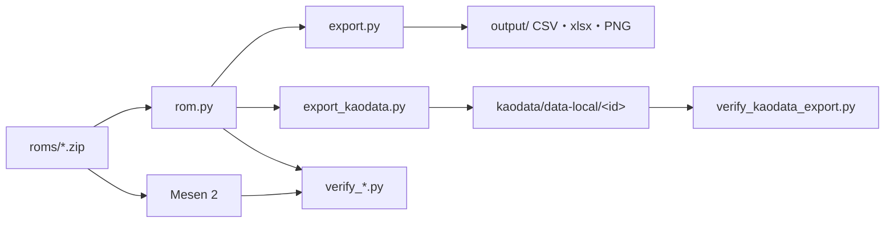

# 專案架構

各遊戲解析的流程與技巧見 [PLAYBOOK.md](PLAYBOOK.md)；已完成的遊戲一覽見根目錄 `CLAUDE.md`。

## 目錄

```
superfamicom-re/
├── roms/                 ROM zip（不進版控）；程式預設直接讀 zip
├── tools/                共用工具（見下）
├── docs/
│   ├── PLAYBOOK.md       新遊戲的解析流程、驗證範本、踩過的坑、分診結果
│   └── ARCHITECTURE.md   本檔
├── BACKLOG.md            待解析的遊戲
├── CLAUDE.md             遊戲一覽與開發慣例
└── <game>/               每款遊戲一個資料夾（20 款）
```

## 每款遊戲的資料夾

```
<game>/
├── rom.py                  解碼：讀 ROM、解壓、把各表解成 Python 資料（沒有 shebang、不 chmod +x）
├── export.py               匯出 CSV（UTF-8-BOM）、xlsx、PNG 到 output/
├── export_kaodata.py       匯出 kaodata/1 資料集（--out <kaodata>/data-local/<id>）
├── verify_kaodata_export.py  資料集用參考渲染器重畫，和 rom.py 逐 pixel 比對；group／name／code；checksums
├── verify_*.py             每項解碼一支，用 Mesen 跑遊戲本身的程式獨立驗證
├── tools/                  遊戲專用的輔助程式（按鍵序列、追蹤 Lua、核對圖）
├── data/                   字碼對照表等人工整理的資料（charset.txt 等）
├── docs/ROM_FORMAT.md      ROM 格式、操作序列、未解部分（繁體中文）
├── README.md               指令、檔案、輸出、進度、驗證結果表（繁體中文）
└── output/                 匯出結果（不進版控）
```

資料流：



驗證腳本把 `rom.py` 的解碼結果和遊戲執行中的記憶體、畫面或函式引數比對；`rom.py` 本身不依賴模擬器。

## 共用工具 `tools/`

| 檔案 | 用途 | 用到的地方 |
|------|------|------------|
| `mesen.py` | ctypes 呼叫 MesenCore（無頭、跑 Lua）；一個 process 只能開一次 | 所有驗證 |
| `drive.py` | 按鍵序列操作遊戲：截圖、dump 記憶體、`--reads` 追蹤 ROM 讀取 | 分析階段 |
| `replay.py` | savestate 重播：存一次檔，之後每輪改 ROM／WRAM、按鍵、在指定幀讀記憶體；`expand()`、`end_frame()` 處理按鍵序列 | 多數 `verify_*.py` |
| `printf_trace.py` | 給 `replay.py` 用的 printf／vsprintf 追蹤 Lua 與解析器 | `teitoku2/`、`sangokushi/` |
| `koei_lz.py` | KOEI LZ 解壓、找解壓表與指標表 | 三國志II、武將風雲錄、航空霸業以外的作品 |
| `kaodata.py` | kaodata/1 的寫入、讀取、參考渲染、checksums | 所有 `export_kaodata.py` |
| `parts_sheet.py` | 組合臉零件總覽圖 | 有組合臉的遊戲 |
| `triage.py` | ROM 分診：標頭、LZ、Shift-JIS 字數 | 新遊戲開工前 |

遊戲資料夾裡的程式用 `sys.path.insert(0, <repo>/tools)` 引用共用工具。

## 遊戲專用的 `tools/`

| 遊戲 | 檔案 | 內容 |
|------|------|------|
| `taikou/`、`teitoku/`、`teitoku2/`、`sangokushi/` | `sequences.py` | 按鍵序列常數；`expand`、`end_frame` 從 `tools/replay.py` 引入 |
| `sangokushi/` | `printf.py` | 以 `tools/printf_trace.py` 攔這款的 printf，換成舊介面（`%s` 給指標） |
| `airmanage/` | `vm.py` | p-code VM 的注入與追蹤 |
| `airmanage2/` | `am2.py` | 包在 `replay.py` 外的按鍵序列、WRAM 位址、printf／頭像繪製 Lua |
| `daikoukai/` | `boot.py` | 從開機到各畫面的按鍵序列 |
| `daikoukai2/` | `replay.py`、`session.py` | 早期自帶的重播實作（共用 `tools/replay.py` 之前寫的） |
| `eiketsu/` | `replay.py` | 早期自帶的重播實作 |
| `bushou/`、`san2/` | `battle_capture.py` | 讓遊戲畫出任一張戰場並讀回 tilemap |
| `bushou/` | `province_probe.py` | 在國畫面寫入標記值截圖，對出各欄位 |
| `san2/` | `build_kanji_map.py`、`kanji_sheet.py` | 用外部人名對出自訂漢字碼、核對圖 |
| `san2/`、`tenshouki/` | `face_capture.py` | 改 ROM 頭像碼截圖 |
| `kouryuuki/`、`san3/`、`san4/` | `charset_sheet.py`、`ext_chars_sheet.py` | 字型與字碼核對圖 |

`daikoukai2/`、`eiketsu/` 的重播實作和共用版功能重疊，沒有改寫是因為驗證已通過、重跑時間長；之後動到這兩款時再改用共用版。

## 外部依賴

- Python：`.venv/`（Pillow、openpyxl）；lint 用 `uvx ruff check --line-length 120`
- Mesen 2 的 MesenCore（見 `tools/mesen.py`）
- kaodata 網站 repo `~/works/kaodata`：資料集放 `data-local/<id>`，`pnpm verify data-local` 驗證；格式規格在它的 `docs/data-format.md`
- FC 版對照：`~/works/famicom-re`；PC 版能力表與頭像：`~/works/kaodata-re`
